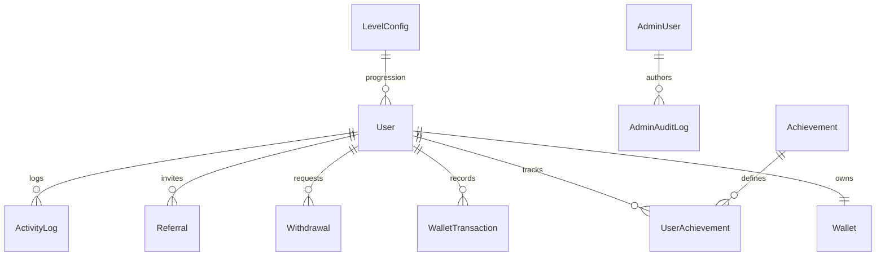

# VELoop Rewards — Database Schema & Architecture

This document outlines the MongoDB schema design, collection models, relationships, indexing strategies, and data integrity safeguards.

---

## 1. Entity-Relationship Overview

---

## 2. Collections & Schemas

### 2.1 `User`
Primary platform identity entity.
- `userId`: `String` (Unique, indexed; e.g. `VLRUSR202600123`)
- `name`: `String` (Display name)
- `email`: `String` (Unique, lowercase, indexed)
- `password`: `String` (Bcrypt salted hash; excluded from default queries with `select: false`)
- `role`: `String` (`user` | `admin`)
- `profileImage`: `String` (URL or avatar reference)
- `referralCode`: `String` (Unique uppercase code; indexed)
- `referredBy`: `String` (Referrer's referral code)
- `accountStatus`: `String` (`ACTIVE` | `SUSPENDED` | `PENDING_VERIFICATION`)
- `statusReason`: `String` (Administrative notes on status change)
- `isEmailVerified`: `Boolean`
- `memberSince`: `Date`

### 2.2 `Wallet`
The financial source of truth for user assets.
- `user`: `ObjectId` (Ref: `User`, unique 1-to-1 relationship, indexed)
- `userId`: `String` (Denormalized for high-performance lookup)
- `ves`: `Number` (Virtual Earnings; min: 0)
- `sves`: `Number` (Silver Virtual Earnings; min: 0)
- `gems`: `Number` (In-app multiplier gems; min: 0)
- `tokens`: `Number` (Event tokens; min: 0)
- `xp`: `Number` (Non-redeemable experience points; min: 0)
- `reservedVes`: `Number` (Locked/frozen VEs pending withdrawal approval)

### 2.3 `WalletTransaction`
Immutable double-entry transaction record generated for every balance change.
- `transactionId`: `String` (Unique, indexed; e.g. `TXN_...`)
- `user`: `ObjectId` (Ref: `User`)
- `asset`: `String` (`ves`, `sves`, `gems`, `tokens`, `xp`)
- `type`: `String` (`CREDIT` | `DEBIT`)
- `amount`: `Number`
- `previousBalance`: `Number`
- `newBalance`: `Number`
- `category`: `String` (`AD_WATCH`, `DAILY_BONUS`, `REFERRAL_REWARD`, `WITHDRAWAL_REQUEST`, `WITHDRAWAL_APPROVED`, `WITHDRAWAL_REJECTED`, `ADMIN_ADJUSTMENT`, etc.)
- `description`: `String`
- `reference`: `String`
- `adminId`: `ObjectId` (Ref: `AdminUser`, null if user activity)

### 2.4 `Withdrawal`
Tracks cash payout redemptions from VEs to INR currency.
- `withdrawalId`: `String` (Unique, indexed)
- `user`: `ObjectId` (Ref: `User`)
- `amount`: `Number` (INR value ₹)
- `vesDeducted`: `Number` (VEs redeemed)
- `payoutMethod`: `String` (`UPI` | `BANK_TRANSFER` | `PAYTM`)
- `payoutDetails`: `Object` (`upiId`, `accountNumber`, `ifscCode`, `holderName`)
- `status`: `String` (`PENDING` | `APPROVED` | `REJECTED`)
- `rejectionReason`: `String`
- `processedBy`: `ObjectId` (Ref: `AdminUser`)
- `processedAt`: `Date`

### 2.5 `LevelConfig`
Dynamic level thresholds and tier configurations.
- `levelNumber`: `Number` (Unique, indexed; 1 to 10)
- `levelName`: `String`
- `xpThreshold`: `Number`
- `badgeIcon`: `String`
- `badgeColor`: `String`
- `isActive`: `Boolean`

### 2.6 `Achievement` & `UserAchievement`
System achievement rules and individual member unlock progression.
- `achievementId`: `String` (Unique)
- `conditionType`: `String` (`XP_THRESHOLD`, `REFERRALS_COUNT`, `WITHDRAWAL_COUNT`, `GEMS_BALANCE`)
- `requiredValue`: `Number`
- `xpReward`: `Number`
- `vesReward`: `Number`
- `isUnlocked`: `Boolean`
- `currentProgress`: `Number`
- `unlockedAt`: `Date`

### 2.7 `Referral`
Peer invite associations and reward distribution records.
- `referrer`: `ObjectId` (Ref: `User`)
- `referredUser`: `ObjectId` (Ref: `User`)
- `status`: `String` (`SUCCESSFUL` | `PENDING` | `SUSPICIOUS`)
- `rewardVes`: `Number`
- `rewardXp`: `Number`

### 2.8 `ActivityLog`
Compact user-facing event stream.
- `type`: `String`
- `title`: `String`
- `description`: `String`
- `amount`: `Number`
- `asset`: `String`
- `status`: `String`

### 2.9 `AdminUser` & `AdminAuditLog`
Administrative credentials and security audit trail.
- Role-based permissions (`SUPER_ADMIN`).
- Tracks action, affected target ID, before/after parameters, timestamp, and IP address.

---

## 3. Database Indexes

To guarantee optimal query performance under high load, the following compound and unique indexes are maintained:

| Collection | Indexed Fields | Purpose |
|---|---|---|
| `users` | `{ email: 1 }`, `{ userId: 1 }`, `{ referralCode: 1 }` | Fast login, profile lookups, and referral validation. |
| `wallets` | `{ user: 1 }`, `{ userId: 1 }` | 1-to-1 balance integrity and rapid ledger queries. |
| `wallettransactions` | `{ user: 1, createdAt: -1 }`, `{ transactionId: 1 }` | Paginated user statement history. |
| `withdrawals` | `{ user: 1, status: 1 }`, `{ status: 1 }` | Fast aggregation of pending and approved payouts. |
| `userachievements` | `{ user: 1, achievementId: 1 }` (Unique compound) | Prevents duplicate user achievement records. |
| `adminauditlogs` | `{ action: 1, createdAt: -1 }`, `{ targetId: 1 }` | High-speed compliance audit lookups. |

